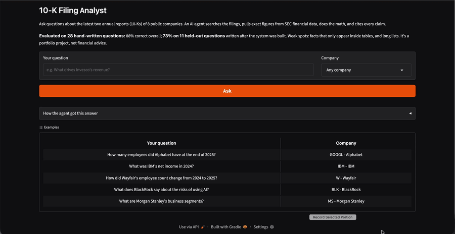

# 10-K Filing Analyst: RAG + Tool-Using Agent, with Evaluation

An AI assistant that answers questions about public companies' annual reports (10-Ks), cites the exact passages behind every claim, and pulls exact financial figures from SEC data instead of guessing. Built with a hand-written evaluation set to measure how often it's actually right.



## Results

Evaluated on **28 hand-written questions** across 8 companies (BlackRock, Invesco, Alphabet, IBM, Macy's, Wayfair, Morgan Stanley, Goldman Sachs), each with an answer verified by hand in the filings.

| Question set | Correct | Partial | Wrong | Correct refusals |
|---|---|---|---|---|
| Development set (17 questions, used while building) | 100% | 0 | 0 | 2/2 |
| **Held-out set (11 questions, written after building, run once)** | **73%** (8/11) | 2 | 1 | 1/1 |
| All answerable questions (25) | 88% | 2 | 1 | 3/3 |

**The held-out number is the honest one.** The development questions shaped the agent's design, so they overstate real performance.

Grading uses an LLM judge (Claude) comparing each answer with the hand-written expected answer. I hand-graded 8 answers blind to the judge's verdict and agreed on all 8 (small sample).

## How it works

1. **Data:** the two most recent 10-Ks for 8 companies, downloaded from SEC EDGAR (`edgartools`).
2. **Indexing:** filings split into 300-word chunks with 50-word overlap, embedded with `BAAI/bge-small-en-v1.5`, stored in Chroma (4,828 chunks).
3. **Agent** (`src/agent.py`): Claude Haiku 5.5 with three tools, up to 6 steps per question:
   - `search_filings`: semantic search over the filings, callable several times
   - `get_financial_fact`: exact reported figures from the SEC XBRL API (e.g. revenue, net income)
   - `calculate`: safe arithmetic (parsed with `ast`, never `eval`)
4. **Answers** must cite every claim (`[S2]` for passages, `[SEC data]` for figures) and say "The filings provided don't answer this" when the tools don't.
5. **Evaluation** (`src/evaluate.py`): for each question, checks **retrieval** (did search find the evidence phrase?) separately from **answer quality** (LLM judge), so failures can be diagnosed.

## Experiments

Every change was measured on the same development questions before being kept.

| Setup | Retrieval hit | Correct | Kept? |
|---|---|---|---|
| Semantic search, top 5 chunks (baseline) | 73% | 80% | ✅ as the retriever |
| Top 8 chunks | 80% | 80% | ❌ no gain, ~60% more tokens |
| 800-word chunks | 13% | 13% | ❌ see below |
| Hybrid BM25 + semantic (RRF) | 67% | 67% | ❌ made it worse |
| **Agent with tools** | 80% | **100%** | ✅ final system |

## What I learned

- **Retrieval was the bottleneck.** In the baseline, every question where search found the right passage was answered correctly; every miss came from retrieval.
- **Bigger chunks collapsed retrieval (73% → 13%).** The embedding model truncates input at 512 tokens (~380 words), so most of each 800-word chunk was invisible to search. Chunk size has to fit the embedding model.
- **Hybrid search, often recommended, made things worse here.** Keyword matching without stemming ("employee" ≠ "employees") added noise that displaced good results in the 5 available slots.
- **The agent fixed what search experiments couldn't:**
  - *Missing data:* IBM's financial statements aren't in its 10-K text; the agent got revenue and net income from SEC XBRL data.
  - *Query rewriting:* asked "How did Wayfair's employee count **change**?", plain search kept retrieving layoff passages. The agent searched "Wayfair number of employees full-time as of December 31" instead, matching the filing's own wording.
- **Failures were safe.** The wrong answer was an honest "the filings don't answer this", not an invented number.

## Error analysis (held-out misses)

| Question | Grade | Cause |
|---|---|---|
| Wayfair orders delivered in 2025 | Wrong (refused) | The figure appears only in a metrics table, flattened into a run of numbers in plain text |
| Goldman Sachs' risk-factor categories | Partial | A list of 7 short headings spread through a long summary; retrieval found 6 |
| Goldman Sachs' leave and wellness benefits | Partial | Right passage found; a six-item answer missed two items |

**Pattern:** facts stated in sentences work well (93% on fact questions); tables and long lists are the weak spots.

## Run it

```bash
git clone https://github.com/lakshyaashetty/filing-analyst.git
cd filing-analyst
python3.12 -m venv .venv && source .venv/bin/activate
pip install -r requirements.txt
```

Create a `.env` file:

```text
EDGAR_IDENTITY="Your Name your.email@example.com"
ANTHROPIC_API_KEY="sk-ant-..."
```

Then:

```bash
python -m src.data                 # download filings from SEC EDGAR
python -m src.index 300            # build the search index
python app.py                      # web app at http://127.0.0.1:7860
python -m src.agent "What was IBM's net income in 2024?" IBM   # or ask from the terminal
python -m src.evaluate final filings_300 5 agent               # rerun the evaluation
```

Cost: well under a cent per question with Claude Haiku 5.5. A full 28-question evaluation run costs a few cents.

## Project structure

```text
app.py                 Gradio web app
src/data.py            download 10-K filings from SEC EDGAR
src/index.py           chunking, embeddings, Chroma index
src/rag.py             retrieval (semantic, keyword, hybrid) and single-call RAG
src/agent.py           tool-using agent: search, SEC XBRL facts, calculator
src/evaluate.py        evaluation: retrieval hit check + LLM judge
src/check_judge.py     hand-grade a sample to validate the judge
src/find.py            search the filings by phrase (for writing test questions)
eval/gold.csv          28 hand-written questions with answers and evidence
eval/results_*.csv     results of each experiment
```

## Limitations and next steps

- **Small evaluation set:** 28 questions; one question moves the held-out score by about 9 points.
- **The retrieval check is strict:** it looks for one exact evidence phrase, so it undercounts when a fact is stated in several places.
- **Tables:** parse tables into structured form when downloading filings.
- **Larger chunks** would need a long-context embedding model.
- **Compare models:** run the same evaluation with other LLMs to compare accuracy, cost and speed.

## Data

Company filings from [SEC EDGAR](https://www.sec.gov/edgar/search/) and the SEC XBRL company-concept API. A portfolio project, not financial advice.
